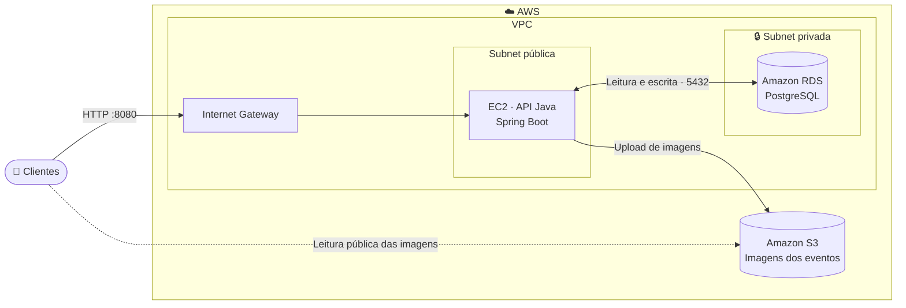
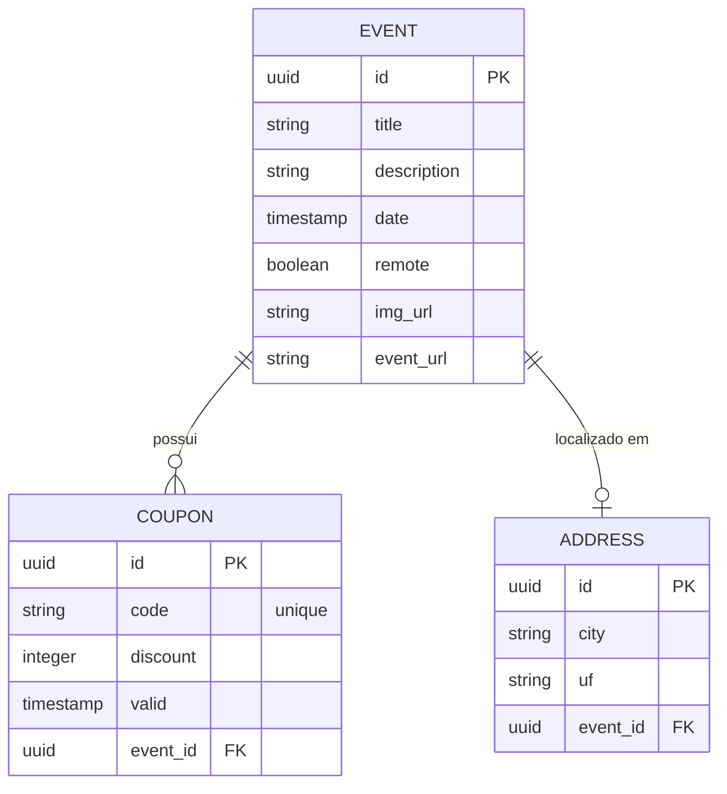

<div align="center">

# 🎟️ EventosTech

**API REST para gerenciamento e descoberta de eventos de tecnologia, rodando na nuvem AWS.**


</div>

---

## 📖 Sobre o projeto

O **EventosTech** é uma API REST para cadastro, listagem e busca de eventos de tecnologia (presenciais ou remotos). Cada evento pode ter imagem de divulgação, endereço e cupons de desconto com data de validade.

O projeto foi pensado também como um estudo prático de **arquitetura em nuvem**: a aplicação roda em uma **EC2** dentro de uma **VPC**, o banco de dados é um **PostgreSQL no Amazon RDS** em subnet privada e as imagens são armazenadas no **Amazon S3**.

## ✨ Funcionalidades

- 📌 Cadastro de eventos com upload de imagem (`multipart/form-data`)
- 🖼️ Armazenamento das imagens no **Amazon S3** com URL pública de leitura
- 📍 Endereço (cidade/UF) vinculado automaticamente a eventos presenciais
- 📅 Listagem **paginada** apenas de eventos futuros
- 🔎 Busca com **filtros** por título, cidade, UF e intervalo de datas
- 🎫 Cupons de desconto por evento, exibindo somente os ainda válidos
- 🗄️ Versionamento do schema com **Flyway**
- 🔐 Configuração sensível via **variáveis de ambiente**

## 🏗️ Arquitetura



**Decisões de segurança**

- O banco fica em **subnet privada**, sem acesso direto pela internet.
- O Security Group do banco só aceita conexões vindas do Security Group da EC2.
- A EC2 acessa o S3 por **credenciais da cadeia padrão da AWS** (IAM), sem chaves no código.
- O bucket libera apenas `s3:GetObject` publicamente; escrita só com permissão IAM.

## 🗃️ Modelo de dados



## 🛠️ Tecnologias

| Camada | Tecnologia |
|---|---|
| Linguagem | Java 21 |
| Framework | Spring Boot 3.3 (Web, Data JPA) |
| Banco de dados | PostgreSQL 16 (Docker local · Amazon RDS em produção) |
| Migrations | Flyway |
| Armazenamento | Amazon S3 (AWS SDK for Java v1) |
| Infraestrutura | Amazon EC2, VPC, Internet Gateway, Security Groups, IAM |
| Testes | JUnit 5 · H2 (perfil `test`) |
| Utilitários | Lombok · Docker Compose · Maven |

## 🔌 Endpoints

Base URL: `/api`

| Método | Rota | Descrição |
|---|---|---|
| `POST` | `/event` | Cria um evento (`multipart/form-data`) |
| `GET` | `/event` | Lista eventos futuros (paginado) |
| `GET` | `/event/{eventId}` | Detalhes do evento e cupons válidos |
| `GET` | `/event/filter` | Busca com filtros |
| `POST` | `/coupon/event/{eventId}` | Adiciona um cupom ao evento |

### Criar evento

`POST /api/event` · `multipart/form-data`

| Campo | Tipo | Obrigatório | Exemplo |
|---|---|---|---|
| `title` | texto | ✅ | `Java Conf 2026` |
| `description` | texto | ❌ | `Evento sobre Java e Spring` |
| `date` | timestamp (ms) | ✅ | `1796083200000` |
| `city` | texto | ✅ | `São Paulo` |
| `uf` | texto | ✅ | `SP` |
| `remote` | booleano | ✅ | `false` |
| `eventUrl` | texto | ✅ | `https://eventos.com/java-conf` |
| `image` | arquivo | ❌ | `banner.png` |

### Listar eventos futuros

```http
GET /api/event?page=0&size=10
```

### Filtrar eventos

```http
GET /api/event/filter?title=java&city=São Paulo&uf=SP&startDate=2026-11-05&endDate=2026-12-31&page=0&size=10
```

Todos os filtros são opcionais. As datas usam o formato `yyyy-MM-dd`.

**Exemplo de resposta**

```json
[
  {
    "id": "8658ac06-8fbf-419e-983e-902be3bce2c3",
    "title": "Java Conf 2026",
    "description": "Evento sobre Java e Spring",
    "date": "2026-12-01T00:00:00.000+00:00",
    "city": "São Paulo",
    "uf": "SP",
    "remote": false,
    "eventUrl": "https://eventos.com/java-conf",
    "imgUrl": "https://<bucket>.s3.us-east-1.amazonaws.com/<uuid>-banner.png"
  }
]
```

## 🚀 Rodando localmente

### Pré-requisitos

- Java 21
- Maven (ou o wrapper `./mvnw`)
- Docker e Docker Compose
- Um bucket S3 e credenciais AWS configuradas (`aws configure`) para o upload de imagens

### 1. Clone o repositório

```bash
git clone https://github.com/obrenoxs/<nome-do-repositorio>.git
cd <nome-do-repositorio>
```

### 2. Suba o PostgreSQL

```bash
docker compose up -d
```

### 3. Configure as variáveis

Os valores padrão já apontam para o banco local do Docker Compose. Para outro ambiente, defina:

| Variável | Descrição | Padrão local |
|---|---|---|
| `DB_URL` | URL JDBC do banco | `jdbc:postgresql://localhost:5432/eventostech` |
| `DB_USER` | Usuário do banco | `postgres` |
| `DB_PASSWORD` | Senha do banco | `postgres` |
| `AWS_PROFILE` | Profile AWS usado pelo SDK (opcional) | `default` |

No `application.properties`, ajuste também `aws.region` e `aws.bucket.name`.

### 4. Execute

```bash
./mvnw spring-boot:run
```

O Flyway cria o schema automaticamente e a API sobe em `http://localhost:8080`.

## ☁️ Deploy na AWS

1. **Rede:** VPC com subnet pública (EC2) e subnet privada (RDS), Internet Gateway e Security Groups.
2. **Banco:** instância RDS PostgreSQL na subnet privada, acessível apenas pelo Security Group da EC2.
3. **Armazenamento:** bucket S3 com policy de leitura pública para `s3:GetObject`.
4. **Permissões:** acesso de escrita ao bucket via IAM (usuário em desenvolvimento, **IAM Role** na EC2).
5. **Build e envio do artefato:**

   ```bash
   ./mvnw clean package -DskipTests
   scp -i <chave>.pem target/api-0.0.1-SNAPSHOT.jar ec2-user@<IP-DA-EC2>:/home/ec2-user/
   ```

6. **Execução na EC2:**

   ```bash
   DB_URL="jdbc:postgresql://<endpoint-rds>:5432/postgres" \
   DB_USER="<usuario>" \
   DB_PASSWORD="<senha>" \
   java -jar api-0.0.1-SNAPSHOT.jar
   ```

## 📁 Estrutura do projeto

```text
src/main/java/com/eventostech/api
├── config          # Configuração do cliente S3
├── controller      # Endpoints REST
├── domain
│   ├── address     # Entidade Address
│   ├── coupon      # Entidade Coupon e DTOs
│   └── event       # Entidade Event e DTOs
├── repositories    # Spring Data JPA
└── service         # Regras de negócio

src/main/resources
└── db/migration    # Migrations do Flyway
```

## 👨‍💻 Autor

**Breno Oliveira de Souza**

[](https://github.com/obrenoxs)
